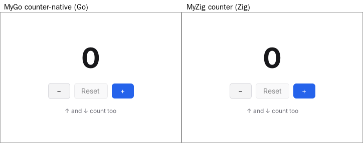

# MyZig

**MyGo's design, in Zig.** An experiment: a desktop app framework built the
way MyGo is (a core that owns all behavior, thin per-platform backends,
native libraries loaded at run time, and native UI that the framework
draws itself from the app's state), with an API in idiomatic Zig.

Step one is done: MyGo's `examples/counter-native` runs on MyZig on Linux and
looks the same, pixel for pixel apart from sub-pixel text placement. Its
numbers are in [Performance](#performance).



```zig
const Counter = struct {
    n: i64 = 0,

    fn view(s: *Counter, c: *ui.Context) void {
        if (c.shortcut(.{}, .up)) s.n += 1;
        if (c.shortcut(.{}, .down)) s.n -= 1;
        const t = c.theme();
        c.column(.{ .fill = true, .center = true, .gap = 16 });
        defer c.end();
        _ = c.textf("{d}", .{s.n}, .{ .font_size = 56, .bold = true });
        {
            c.row(.{ .gap = 8 });
            defer c.end();
            if (c.button("−", .{ .key = "decrement", .label = "Decrement", .width = 44 }).clicked()) s.n -= 1;
            if (c.button("Reset", .{ .key = "reset", .disabled = s.n == 0 }).clicked()) s.n = 0;
            if (c.button("+", .{ .key = "increment", .label = "Increment", .width = 44, .variant = .primary }).clicked()) s.n += 1;
        }
        _ = c.text("↑ and ↓ count too", .{ .font_size = 12, .color = t.text_muted });
    }
};

pub fn main(init: std.process.Init) !void {
    var counter: Counter = .{};
    var app: myzig.App = try .init(init.gpa);
    defer app.deinit();
    _ = try app.createWindow(.{
        .title = "Counter",
        .width = 360,
        .height = 260,
        .content = ui.view(&counter, Counter.view),
    });
    app.run();
}
```

## Commands

Zig 0.16.

```sh
zig build                   # the examples, in zig-out/bin
zig build counter           # run the counter
zig build test              # unit tests, and the counter's test, without a display
zig build -Doptimize=ReleaseSmall -Dstrip=true      # a release build
zig build -Dtarget=aarch64-linux-gnu                # cross-compiles: nothing links against GTK
zig build bench -- [-runs 10] [-clicks 200] app...  # startup, click latency and CPU, on an X display
MYZIG_FRAME_STATS=all zig-out/bin/counter           # each frame's timings, as MYGO_FRAME_STATS
```

## From MyGo to MyZig

The layers and the threading model are MyGo's (see
[docs/architecture.md](../docs/architecture.md)). How each part maps to Zig:

| MyGo | MyZig | Why |
| --- | --- | --- |
| `mygo.App`, a global | `myzig.App`, a value `init` returns, with `deinit` | Zig has no hidden globals; the allocator is passed in |
| backend chosen by build tags, behind an interface | `platform.Backend`, chosen with `switch (builtin.os.tag)` | calls are direct, and Zig compiles only what is referenced |
| purego `dlopen`, one `mustBind` per function | `c.zig`: a struct of function pointers per library, filled by comptime reflection | declaring a field binds a function; `gtk.window_new(.toplevel)` |
| purego callbacks, scarce and never freed | plain `callconv(.c)` functions | Zig has a C ABI: callbacks cost nothing |
| `ui.View(func(c *ui.Context))`, closures | `ui.view(&state, State.view)`: a pointer and a function, as `std.mem.Allocator` | Zig has no closures |
| `ui.Column(c).Fill().Center().Children(func() {...})` | `c.column(.{ .fill = true, .center = true }); defer c.end();` | option structs with defaults, and `defer` instead of closures |
| `ui.PrimaryButton(c.Key("increment"), "+").Width(44)` | `c.button("+", .{ .key = "increment", .width = 44, .variant = .primary })` | |
| `ui.Textf(c, "%d", n)` | `c.textf("{d}", .{n}, .{})` | `std.fmt`, into the frame's arena |
| garbage collector | an arena per frame, reset by the next one; retained lists elsewhere | a frame allocates nothing once the lists have grown |
| `ui.NewTester` | `ui.Tester`, with a text system without fonts | |
| `MYGO_FRAME_STATS` | `MYZIG_FRAME_STATS` | |

Nothing links against GTK: as MyGo does with purego, MyZig `dlopen`s GLib,
GObject, GDK, GTK 3, cairo and Pango, so a program builds on any machine for
any other (`-Dtarget=aarch64-linux-gnu`, `x86_64-linux-musl` and
`aarch64-macos`, `x86_64-windows` build here too, where `App.init` fails
with `error.Unsupported` until those backends exist).

## What exists

- `App`, windows with native UI on Linux (GTK 3, a `GtkDrawingArea`
  showing frames drawn in memory, as MyGo where OpenGL would not run on a
  GPU), the event loop and posting work to it from any thread.
- `ui`: columns and rows laid out as MyGo's flexbox (border boxes, gaps,
  padding, justify and align, fixed and percentage sizes), texts and
  buttons in MyGo's theme (hover, pressed, disabled, primary), the pointer,
  shortcuts, the keyboard focus with Tab and its ring, Enter and Space on a
  focused button, and building again when a build took input, so no frame
  shows the state from before it.
- Text from Pango, with the desktop's font and font options, laid out once
  and kept while frames draw it.
- A CPU renderer: rounded rectangles with borders, antialiased from signed
  distances, and text drawn by cairo into the same pixels.

Not yet: macOS and Windows backends, the GPU renderers, damage tracking
(every frame redraws the window), the rest of the widgets, text input and
input methods, accessibility, web pages, menus, dialogs and the CLI.

## Performance

MyGo's `examples/counter-native` (built as its benchmarks build it:
`-trimpath -tags mygo_noinspector -ldflags "-s -w -X …production=1"`)
against MyZig's `examples/counter` (`-Dstrip=true`), on Linux x86_64 (4
cores of a Xeon at 2.8 GHz), Xvfb at 800x600, scale 1, no window manager.
Memory is MyGo's own `internal/idlemem` (the proportional set size once
idle, median of 5); the rest is `zig build bench` (10 launches of each, 200
clicks on "+" in each).

| | MyGo `counter-native` | MyZig `counter`, ReleaseSmall | MyZig `counter`, ReleaseFast |
| --- | ---: | ---: | ---: |
| Binary | 9.28 MB | 0.23 MB | 0.43 MB |
| Memory once idle, Xvfb without GLX | 34.8 MB | 24.9 MB | 25.3 MB |
| Memory once idle, Xvfb with GLX (GTK loads Mesa) | 85.9 MB | 76.1 MB | 76.3 MB |
| Threads | 13 | 2 | 2 |
| Exec to first frame, without GLX / with GLX | 94 / 94 ms | 62 / 71 ms | 65 / 63 ms |
| Click to the frame showing it, median (p90) | 17.0 (17.5) ms | 16.2 (17.1) ms | 16.2 (17.0) ms |
| CPU time a click takes, without GLX / with GLX | 1.58 / 1.62 ms | 1.29 / 1.33 ms | 1.20 / 1.21 ms |

What the numbers say:

- **Size** is the clearest difference: MyGo's binary carries the Go
  runtime and all of `ui` and the backend whatever the app uses, where Zig
  compiles only what the counter references. MyGo does far more (GPU
  renderers, accessibility, input methods, web pages…); a MyZig with all
  of that would be larger, but would still only pay for what an app uses.
- **Memory** once idle is about 10 MB lower, most of it the Go binary's own
  pages (8.8 MB of MyGo's 33 MB are its executable), the rest the Go
  runtime's heap and its 13 threads (MyZig has 2: GTK's). GTK, cairo,
  Pango and fontconfig are the same in both, and on a display with GLX GTK
  loads Mesa into both (some 45 MB, mostly LLVM).
- **Startup** to the first frame is some 25 to 30 ms faster: loading and
  initializing a smaller binary and no Go runtime. Both spend some 12 ms of
  their first frame loading fonts in Pango.
- **A click** shows on the next frame of GTK's frame clock in both, so the
  latency is the same; MyZig spends 0.3 to 0.4 ms less CPU on each. Of the
  1.2 to 1.6 ms a click costs, GTK, X and copying the frame to X take most;
  building, layout and painting the counter take 0.3 to 0.8 ms in both
  (`MYZIG_FRAME_STATS`, `MYGO_FRAME_STATS`), though MyZig redraws the whole
  window each frame where MyGo redraws what changed.

So Zig makes apps smaller, quicker to start and somewhat lighter, but for a
UI like this the time goes to the toolkit and the display server, which are
the same for both: the frames themselves cost about the same.
